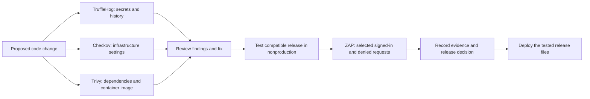
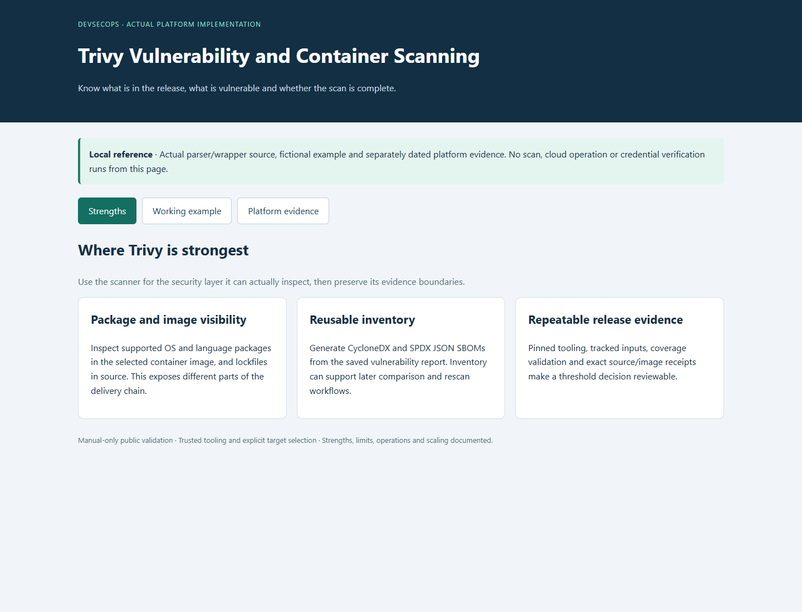
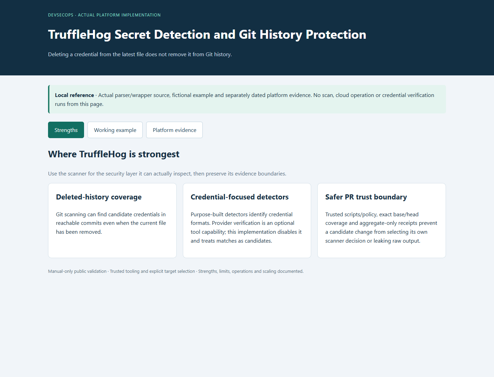
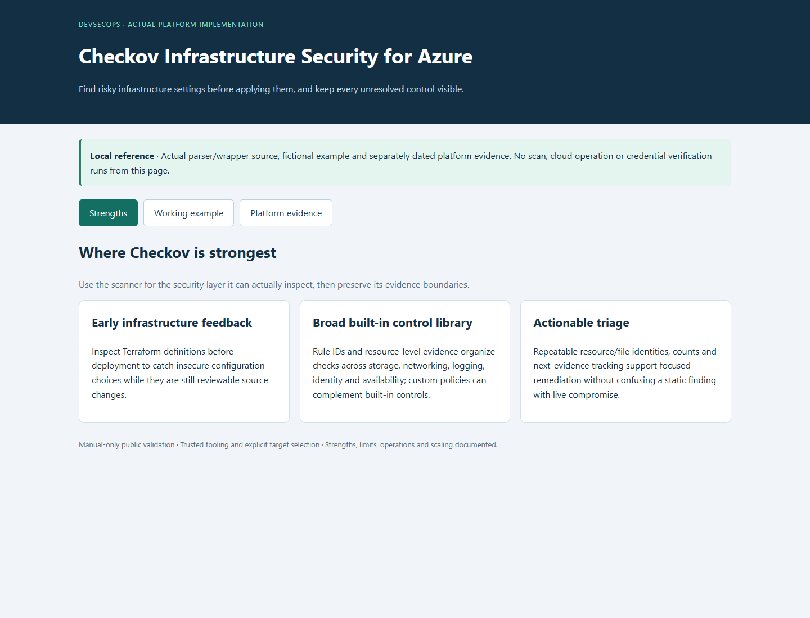
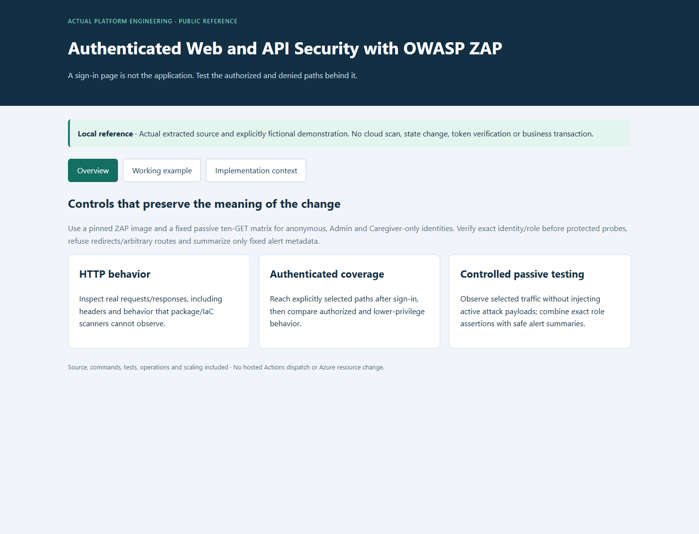

# Layered Security Testing for an Azure Platform

**Find exposed secrets, risky infrastructure settings, vulnerable software and problems visible only after sign-in—then track the fixes.**

[Business problem](#the-business-problem) · [What was built](#what-was-built) · [Proof](#proof-it-works) · [Run the examples](#run-the-examples)

## The Business Problem

A healthcare workforce platform handles private documents and staff-only actions. One security tool cannot check every way those records could be exposed. A clean container scan says little about a leaked key, an unsafe storage setting or a page that gives the wrong user access.

The engineering challenge was to combine useful checks without publishing credentials, hiding unfinished findings or consuming unnecessary pipeline minutes.

## The Solution

Use four complementary tools and record the code or container version each one checked. Confirm both that a scan finished and that its findings meet the release requirements. Review findings, fix what can be fixed, test compatibility and keep unresolved work visible.

**Business outcome:** Security review covers several failure modes rather than depending on one scanner. Recorded fixes removed seven reported vulnerability entries; remaining software and infrastructure findings stayed visible. A limited authenticated test also checked permitted and denied access without exposing private responses.

## What Each Tool Checks

| Tool | Main question | Strength | Limit or tradeoff |
| --- | --- | --- | --- |
| **[TruffleHog](tools/trufflehog/README.md)** | Did a credential enter the repository or its history? | Finds candidates even after their files were deleted. | Matches require private review; deleting a file does not revoke a real secret. This implementation disables online credential verification. |
| **[Checkov](tools/checkov/README.md)** | Does the infrastructure code contain risky settings? | Flags problems before Azure resources are changed. | A failed rule needs context; code inspection does not prove the deployed setting or authorize paid changes. |
| **[Trivy](tools/trivy/README.md)** | What vulnerable packages are in the application or image? | Covers software packages, container operating systems and SBOM inventories. | Results depend on the scanned version and advisory database. A package update still needs application testing. |
| **[OWASP ZAP](tools/zap/README.md)** | How does the running web/API respond to selected users? | Observes runtime behavior, including signed-in and denied requests. | This example is a small passive, read-only sample; it is not a full penetration test. |

## Architecture



This diagram explains the review sequence. It does not claim every stage is enforced automatically in every deployment. The included code and results show which checks were implemented.

## What Was Built

- Secret scanning that keeps possible credential values out of public summaries and uses rules from the trusted base version of the repository.
- Infrastructure rule review with visible failures, documented follow-up and related Terraform examples.
- Software and container findings, package inventories, and a release rule that blocks High or Critical issues when a fix is available.
- Authenticated passive web/API checks that compare allowed and denied responses while excluding tokens and private response bodies.
- Local demonstrations, focused tests, screenshots, commands, source mappings and operating guidance for all four components.

The component folders retain their original layout so commands and relative links continue to work. Their nested `.github` directories preserve reference workflows; only the root `.github/workflows` directory can define workflows for this repository.

## Proof It Works

These are **historical scan and test results from the original projects**. They are not a fresh assessment of the platform:

| Layer | Recorded evidence | What it establishes |
| --- | --- | --- |
| Trivy | Seven reported vulnerability entries removed; 21 Medium and one Low remained in the recorded source scan. | Fixes were measured without claiming a completely clean release. |
| Checkov | 508 resources across 228 inputs; 211 passed, 106 failed; no skipped checks or parsing errors. | The scan completed and its outstanding failures were preserved. Counts describe checks, not unique resources. |
| TruffleHog | Three reviewed candidates identified as public package hashes. | Narrow candidate review without broad future exclusions. |
| ZAP | Ten read-only requests across four server handlers; two informational cache observations and no Low/Medium/High alerts in that sample. | Limited authenticated coverage, not assurance about untested routes. |

The [consolidation source map](docs/CONSOLIDATION-SOURCES.json) records the exact public component commits and file hashes copied into this project. Later scans can differ as code and advisory databases change.

### Screenshots

The screenshots below are local reference views with fictional data, not Azure portal captures or live employee records.

| Software and infrastructure | Secrets and runtime access |
| --- | --- |
|  |  |
|  |  |

## Run the Examples

Python 3.12 and Node.js 22 are the reference runtimes. These commands run local contract tests and fictional demonstrations; they do not start Azure services, run live attack scans or deploy infrastructure.

```bash
git clone https://github.com/truthofsource/azure-devsecops-security-scanning.git
cd azure-devsecops-security-scanning
for tool in trufflehog checkov trivy zap; do
  (cd "tools/$tool" && python -B -m unittest discover -s scripts -p 'test_*.py' -v && python -B scripts/demo.py) || exit 1
done
```

Actual scanner commands and prerequisites are documented separately: [Trivy](tools/trivy/docs/COMMANDS.md), [Checkov](tools/checkov/docs/COMMANDS.md), [TruffleHog](tools/trufflehog/docs/COMMANDS.md), and [ZAP](tools/zap/docs/COMMANDS.md). Inspect targets and permissions before adapting those commands. Related infrastructure code remains under the Trivy and Checkov component folders.

The root GitHub Actions check is manual-only and runs these local examples. It does not run the four real scanners, deploy Azure resources or prove current cloud security. No Actions run was dispatched to publish this consolidation.

Checks after combining the projects: **52 tests passed; two optional integration tests skipped**. [Full validation scope](docs/VALIDATION.md).

## Operations, Scaling and Tradeoffs

Check changed files and affected container images for quick feedback, then run broader scans separately. Reuse a verified scanner installation or image and retain small summaries plus the exact checked version. Keep raw secret candidates and authenticated traffic private.

As the platform grows, assign findings to service owners, give exceptions expiry dates, and separate package updates from infrastructure changes that affect cost or connectivity. Broader authenticated coverage needs explicit route and role inventories; active testing needs a separate safe target and authorization.

Four tools add maintenance, report volume and false-positive review. Their value comes from complementary coverage, a clear repair process and visible follow-up work.

## Troubleshooting

| Symptom | Check first |
| --- | --- |
| An empty report appears clean | Confirm successful completion, target coverage and parsing before using counts. |
| A secret was removed but still appears | Check Git history; if real, revoke/rotate it before considering history cleanup. |
| Checkov proposes a costly setting | Review the rule and deployed architecture; do not apply paid resources automatically. |
| A patched package still appears vulnerable | Confirm the lockfile and exact image digest were rebuilt and rescanned. |
| ZAP only sees a login page | Verify the test session, role and allowed read-only requests without logging tokens. |

## Boundaries

This public project draws on actual Azure engineering work, with identifying details removed and fictional examples. It contains no employee records or live credentials. Malware scanning of uploaded documents remains a [separate project](https://github.com/truthofsource/secure-serverless-document-processing), because checking a user's file is a different control from checking application releases.

The four original repositories remain available for existing links. This repository is the combined portfolio entry.
