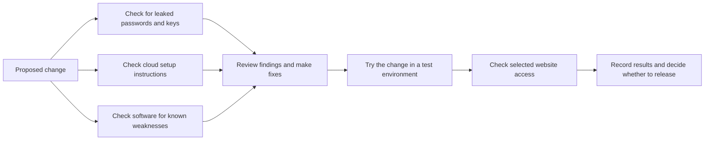
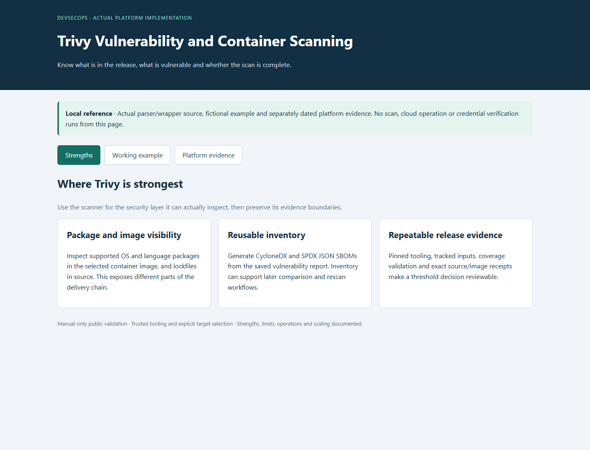
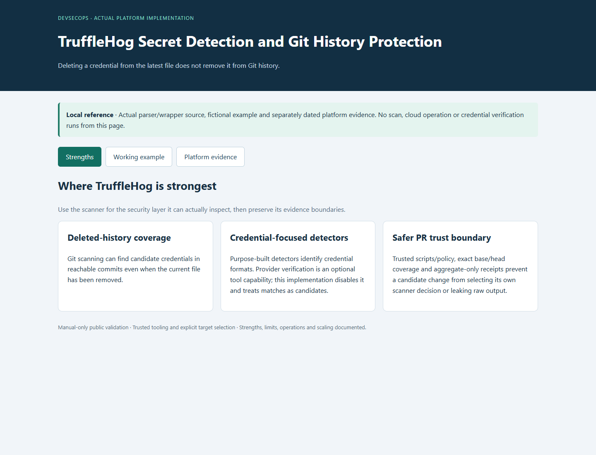
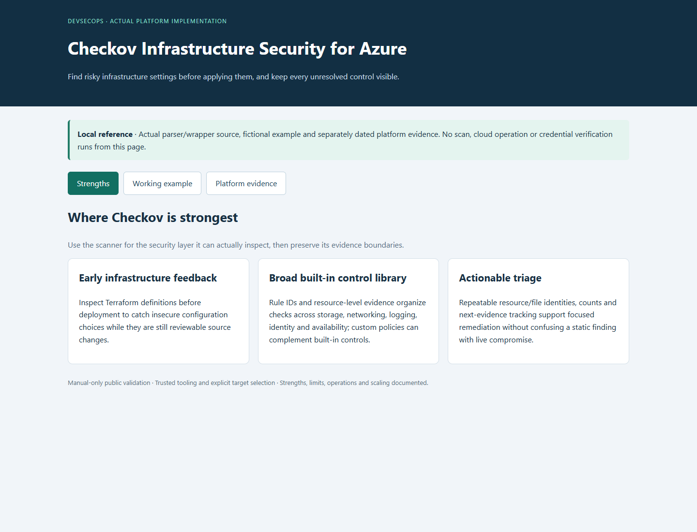
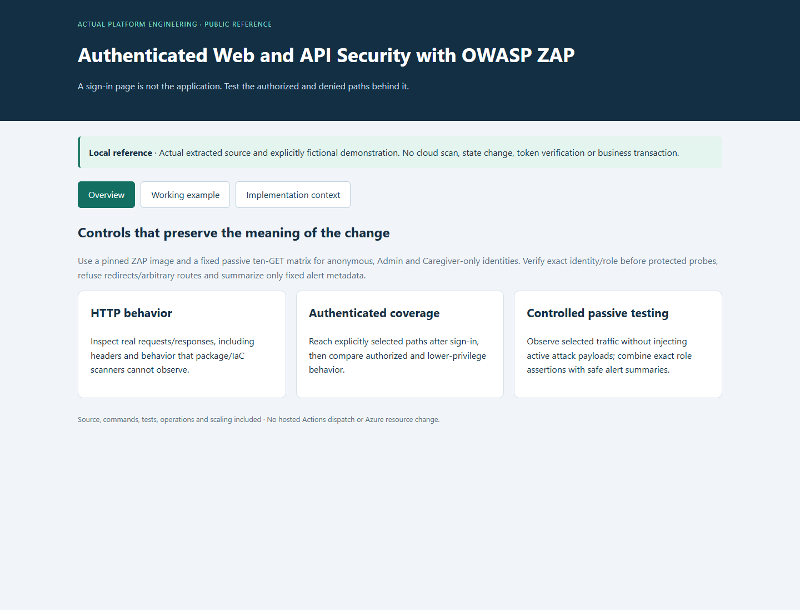

# Layered Security Testing for an Azure Platform

**Check for security problems in four different places, then keep track of the fixes.**

[Business problem](#the-business-problem) · [What was built](#what-was-built) · [Proof](#proof-it-works) · [Run the examples](#run-the-examples) · [Step by step](#step-by-step)

## The Business Problem

The platform handles private staff records and supports actions with different consequences, from reading a document to changing employee access or processing payroll work. Weaknesses can enter through a leaked credential, a dependency, an infrastructure setting or an application permission error. Each creates a different investigation and repair task.

A single scanner leaves gaps, while disconnected reports make it difficult to see which findings apply to the release being considered. A completed scan can also be mistaken for a clean result. Engineers need to know what was checked, which repairs were tested, what remains unresolved and which changes carry cost or operational consequences.

The business need was a coordinated view of security evidence and follow-up, so release decisions reflect the selected version and known limitations rather than a collection of unrelated green checks.

## The Solution

I combined four security tools, each with a different job. Together they check saved code, cloud setup, the software used by the application and selected pages after sign-in.

**Business outcome:** The team has a clearer view of several kinds of security risk and the work needed to address them. Recorded software updates removed seven entries from the findings report. Other findings remained visible for follow-up.

## Tools Used and What They Do

| Tool or service | What it does | Where it fits |
| --- | --- | --- |
| Trivy | Check dependencies and selected container contents for known weaknesses. | Actual scanner role; package inventory and completion must be established. |
| Checkov | Review infrastructure configuration against its rule set. | Actual IaC scanner; source results are separate from live resource state. |
| TruffleHog and Git | Inspect selected files/history for possible leaked credentials. | Actual secret-detection boundary; raw candidates remain private. |
| OWASP ZAP | Observe the selected web/API behavior, including bounded signed-in requests. | Actual runtime-security boundary, not whole-platform assurance. |
| Playwright and Chromium | Support the platform’s browser-session and PDF acceptance checks. | Acceptance utilities; not a replacement for ZAP or a live session in the demo. |
| Docker and Terraform | Supply image targets and infrastructure source to the relevant checks. | Inputs/build infrastructure, not additional equivalent scanners. |
| Python and GitHub Actions | Run the combined public contract examples. | Manual-only reference CI; it does not run all four real scanners or deploy Azure. |

The component folders retain their original source mappings. The tools answer different questions, and no single green result establishes that every layer is secure.

## Step by Step

Your own four-layer security check: secrets, infrastructure settings, package/image vulnerabilities and a running-web baseline.

[Open the standalone build guide](docs/BUILD-YOUR-OWN.md) or follow the same complete instructions below.

Start with a new folder, your own files and your own accounts. The numbered steps below describe the build; no portfolio repository checkout is required. The existing implementation/evidence elsewhere in this repository is a separate reference, not a claim that your new build has already passed.

### Prerequisites

A new repository, Python, Git, Docker, Terraform and separately installed/reviewed Trivy, Checkov, TruffleHog and ZAP versions. No Azure credential is needed for the source/local web checks.

Use Bash on Linux/macOS/WSL for Bash blocks and PowerShell for PowerShell blocks. Select the tool versions supported by the official sources below, record the versions you actually install and retain generated dependency locks. Cloud resources, scanner downloads, logs and external AI calls can create costs; review the stated scope before enabling them.

### Create your project folder

Choose a new folder name. These first commands create a blank project; an optional `git init` gives it its own history. Create parent directories in your editor when a later step introduces a nested file.

```bash
mkdir my-azure-devsecops-security-scanning
cd my-azure-devsecops-security-scanning
git init
```

Create `.gitignore` before saving credentials or build outputs:

```gitignore
.venv/
node_modules/
.env
.env.*
local.settings.json
credentials.json
token.json
*.pem
*.key
*.tfstate*
*.tfplan
.terraform/
private*/
captures/
backups/
batch.json
reports/
out/
app-config.local.yaml
```

The source/file snippets are a starting implementation you type or paste into the named files. Replace `YOUR_*`, names, regions and addresses only with values from your own lab; do not place real client/employee records in a test project. Keep your terminal in this project root unless a step explicitly changes directory.

Before a first commit, set your own repository-local author with `git config user.name "YOUR_NAME"` and `git config user.email "YOUR_PUBLIC_COMMIT_EMAIL"`. Review `git status --short` and the staged diff before publishing; ignored local files are not a substitute for reviewing what you upload.

### Step 1 — Define what each tool owns

**Where:** A coverage.md file.

Map TruffleHog to secret candidates, Checkov to IaC settings, Trivy to dependencies/images and ZAP to the running web surface. Define severity/exception ownership and make tool failure a separate outcome from findings.

**Check before continuing:** You have four complementary inputs and no claim that one scanner proves complete security.

### Step 2 — Author your infrastructure fixture

**Where:** Your new infra directory.

Create infra/main.tf below. Scan this deliberate weakness without deploying it; later replace the weak TLS setting and compare findings.

Create **`infra/main.tf`** with the following contents:

```hcl
resource "azurerm_storage_account" "lab" {
  name                     = "myuniquelabstorage"
  resource_group_name      = "rg-my-scanner-lab"
  location                 = "eastus2"
  account_tier             = "Standard"
  account_replication_type = "LRS"
  min_tls_version          = "TLS1_0"
}
```

**Check before continuing:** The configuration is your own source input.

### Step 3 — Create your application and dependency input

**Where:** Your new app directory.

Create app/server.mjs and app/Dockerfile below. This small local service has no package dependencies; a source scan can correctly report none, while the image still has its own OS/runtime packages to inspect. Create the accompanying .dockerignore before building: .gitignore does not restrict the Docker context, and only the listed runtime files are allowed into this example's context.

Create **`app/server.mjs`** with the following contents:

```javascript
import http from 'node:http';
const server = http.createServer(async (req, res) => {
  const send = (status, value) => {
    res.writeHead(status, {'content-type': 'application/json'});
    res.end(JSON.stringify(value));
  };
  if (req.method === 'GET' && req.url === '/') {
    res.writeHead(200, {'content-type': 'text/html; charset=utf-8'});
    return res.end('<!doctype html><html lang="en"><title>My scanner lab</title><h1>My scanner lab</h1><a href="/api/health">Health</a></html>');
  }
  if (req.method === 'GET' && req.url === '/api/health')
    return send(200, {service: 'my-api', status: 'ok'});
  if (req.method === 'POST' && req.url === '/api/applications') {
    if ((req.headers['content-type'] || '').split(';')[0].trim().toLowerCase() !== 'application/json')
      return send(415, {error: 'Use Content-Type: application/json'});
    let chunks = [], bytes = 0, tooLarge = false;
    for await (const chunk of req) {
      bytes += chunk.length;
      if (bytes > 4096) { tooLarge = true; chunks = []; }
      else if (!tooLarge) chunks.push(chunk);
    }
    if (tooLarge) return send(413, {error: 'Request too large'});
    const raw = Buffer.concat(chunks).toString('utf8');
    let body;
    try { body = JSON.parse(raw); }
    catch { return send(400, {error: 'Send valid JSON'}); }
    if (typeof body?.name !== 'string' || !body.name.trim() ||
        body.name.length > 100 || typeof body?.email !== 'string' ||
        body.email.length > 254 || !/^[^\s@]+@[^\s@]+\.[^\s@]+$/.test(body.email))
      return send(422, {error: 'A name and valid email are required'});
    return send(202, {status: 'validated-not-saved'});
  }
  if (req.url === '/api/timesheets')
    return send(401, {error: 'Configure and validate staff authentication before enabling this route'});
  return send(404, {error: 'Route not found'});
});
server.requestTimeout = 10000;
server.headersTimeout = 5000;
server.listen(8080, '0.0.0.0');
```

Create **`app/Dockerfile`** with the following contents:

```dockerfile
FROM node:22-bookworm-slim
WORKDIR /app
COPY server.mjs ./
USER node
CMD ["node", "server.mjs"]
```

Create **`app/.dockerignore`** with the following contents:

```dockerignore
**
!Dockerfile
!server.mjs
```

**Check before continuing:** You can identify what source/package/image each result belongs to.

### Step 4 — Run the three source/history controls

**Where:** Your project root.

Run the commands below with your installed versions and keep their exit codes and private raw reports. Findings can produce nonzero statuses; do not use blanket success overrides or upload secret-bearing raw output.

```bash
mkdir -p reports
trufflehog git "file://$PWD" --no-verification --json > ../private-secret-findings.json
checkov --directory infra --framework terraform --output json > reports/checkov.json
trivy fs --scanners vuln --format json --output reports/trivy-source.json app
```

**Check before continuing:** Each tool has an explicit completed/failed result and owned findings.

### Step 5 — Scan a built image and owned web target

**Where:** Your local Docker environment.

Build your own app image and run a Trivy image scan of its exact selected image. Run ZAP baseline against only your local/authorized app using a lab network and retained report, following the separate tool's official invocation. Confirm GET / returns the lab HTML and /api/health returns JSON before running ZAP; a container merely being Running is not an application readiness test.

```bash
docker build -t my-scanned-web:lab app
trivy image --format json --output reports/trivy-image.json my-scanned-web:lab
docker network create my-scanner-net
docker run -d --name my-scanned-web --network my-scanner-net my-scanned-web:lab
# Select a reviewed ZAP image and make reports writable by its runtime user first.
docker run --rm --network my-scanner-net -v "$PWD/reports:/zap/wrk:rw"   ghcr.io/zaproxy/zaproxy:YOUR_REVIEWED_TAG   zap-baseline.py -t http://my-scanned-web:8080 -r combined-web.html
```

**Check before continuing:** Source, image and web reports are not treated as interchangeable evidence.

### Step 6 — Fix and verify one issue per layer

**Where:** Your source files and report notes.

Remove/rotate a genuine secret if one exists, correct an IaC setting, update a selected vulnerable package/image dependency and investigate a web finding. Rescan the same inputs, retaining the original results and explaining any unresolved risk.

**Check before continuing:** Your evidence records specific fixes and remaining findings rather than a blanket secure label.

### Step 7 — Add your own manual CI check

**Where:** Your own repository → .github/workflows.

Implement these commands as separate, version-pinned jobs using workflow_dispatch while building the lab. Give source scans read-only repository permissions, isolate web targets, retain only safe artifacts and keep deployment authority separate.

```bash
docker rm -f my-scanned-web
docker network rm my-scanner-net
```

**Check before continuing:** The pipeline can run against your own authored files without starting cloud services.

### Verification and your own screenshots

| Evidence | What to record | Your result |
| --- | --- | --- |
| New build | Your own files/resource settings and tool versions | Not yet recorded |
| Working path | The actual successful request, configuration or recovery result | Not yet recorded |
| Failure boundary | A meaningful denied, malformed, stale or failed case | Not yet recorded |
| Recovery / cleanup | What you restored or removed and what remains billed | Not yet recorded |

Capture your own architecture/configuration, one working result and one failure/recovery result. Keep tokens, credentials, personal records and private identifiers out of public screenshots. Existing portfolio images are references, not evidence that you performed these steps.

### Troubleshooting order

1. Confirm the named file, working directory and selected tool/interpreter.
2. Check the exact input and resource/account selected for the failing step.
3. Separate identity permission, network/DNS reachability and application validation.
4. Keep the actual error and reconcile an unknown write outcome before repeating it; do not widen access or repeat paid operations blindly.

The numbered steps describe a build procedure. Local syntax checks, an accepted API request, a completed hosted operation and a human verification are different evidence levels; fill in the verification table with what you actually observed.

### Official implementation references

- [trivy.dev — docs](https://trivy.dev/latest/docs/)
- [www.checkov.io — www.checkov.io](https://www.checkov.io/)
- [github.com — trufflehog](https://github.com/trufflesecurity/trufflehog)
- [www.zaproxy.org — baseline-scan](https://www.zaproxy.org/docs/docker/baseline-scan/)
- [docs.docker.com — #dockerignore-files](https://docs.docker.com/build/concepts/context/#dockerignore-files)

The walkthrough layout follows the prerequisites → creation/configuration → test → verification → troubleshooting → cleanup pattern of the [Splunk project reference](https://github.com/davidharris6/splunk-siem-log-analysis). Its Splunk-specific settings are not copied into unrelated projects.

<details>
<summary>Reference: how the existing platform implementation operates</summary>

A short walkthrough of the process, with technical instructions and evidence limits in the sections below.

1. **Choose the change to check** — Identify the code, cloud setup or application version under review. Keep the results tied to that specific version.

2. **Run the checks for each risk (Trivy, Checkov, TruffleHog and ZAP)** — TruffleHog looks for exposed secrets, Checkov reviews cloud setup instructions and Trivy checks software weaknesses. ZAP separately observes selected website and server requests, including signed-in access.

3. **Review and repair the findings** — Confirm that each check finished and investigate its findings. Apply suitable fixes and test that the application still works.

4. **Record the release decision** — Keep the results and unresolved work visible to the reviewer. A completed scan supports a decision but does not establish that the whole platform is secure.

</details>

## What Each Tool Checks

| Tool | What it looks for | Why it helps |
| --- | --- | --- |
| **[TruffleHog](tools/trufflehog/README.md)** | Passwords, access keys or similar secrets accidentally saved in code, including older versions. | Editing a file does not remove a secret from its history. |
| **[Checkov](tools/checkov/README.md)** | Risky settings in the instructions used to set up Azure resources. | Problems can be reviewed before those settings are applied. |
| **[Trivy](tools/trivy/README.md)** | Software with known security weaknesses in the application or its packaged runtime. | The team can identify affected software and available updates. |
| **[OWASP ZAP](tools/zap/README.md)** | Problems visible when selected users access the running website and its server functions. | It checks behavior that a review of saved files alone cannot establish. |

A container is a package used to run an application and its supporting software. An API is the set of server functions a website or another program calls. Those terms appear in the detailed guides.

## Architecture



This shows how the checks fit together. The guides explain which steps were automated and which required separate review.

## What Was Built

- Checks for accidentally saved secrets, with private handling of possible matches.
- Checks of cloud setup instructions and software security updates.
- A limited website check comparing users who should be allowed access with users who should be refused.
- Example results, tests, screenshots and instructions for investigating findings.

Each tool keeps its own folder and guide. [Technical source records](docs/CONSOLIDATION-SOURCES.json) identify the exact versions included.

## Proof It Works

The included results show both improvements and remaining work:

| Evidence | Recorded result |
| --- | --- |
| Software review | Seven reported vulnerability entries removed; 21 Medium and one Low remained in the recorded source scan. |
| Cloud setup review | 211 checks passed and 106 failed in the recorded scan; failures remained available for review. |
| Secret review | Three possible matches were checked and identified as public software-package hashes rather than credentials. |
| Website access review | Ten read-only requests were checked, with two informational observations and no Low, Medium or High alerts in that limited sample. |
| Local checks after combining the projects | 52 tests passed; two optional integration tests were skipped. |

These are recorded results from specific checks, not a new assessment of today's platform. [What the checks cover](docs/VALIDATION.md).

<details>
<summary>For engineers: detailed results, examples and commands</summary>

These are **historical scan and test results from the original projects**. They are not a fresh assessment of the platform:

| Layer | Recorded evidence | What it establishes |
| --- | --- | --- |
| Trivy | Seven reported vulnerability entries removed; 21 Medium and one Low remained in the recorded source scan. | Fixes were measured without claiming a completely clean release. |
| Checkov | 508 resources across 228 inputs; 211 passed, 106 failed; no skipped checks or parsing errors. | The scan completed and its outstanding failures were preserved. Counts describe checks, not unique resources. |
| TruffleHog | Three reviewed candidates identified as public package hashes. | Narrow candidate review without broad future exclusions. |
| ZAP | Ten read-only requests across four server handlers; two informational cache observations and no Low/Medium/High alerts in that sample. | Limited authenticated coverage, not assurance about untested routes. |

The [consolidation source map](docs/CONSOLIDATION-SOURCES.json) records the exact public component commits and file hashes copied into this project. Later scans can differ as code and advisory databases change.

### Screenshots

The screenshots below are local reference views with fictional data, not Azure portal captures or live employee records.

| Software and infrastructure | Secrets and runtime access |
| --- | --- |
|  |  |
|  |  |

</details>

<a id="run-the-examples"></a>

## Optional reference implementation

This section records the existing portfolio implementation and its historical local checks. It is not a prerequisite for the from-scratch build above.

The examples can be run locally. They use fictional inputs and do not connect to Azure or real user accounts.

<details>
<summary>For engineers: detailed results, examples and commands</summary>

Python 3.12 and Node.js 22 are the reference runtimes. These commands run local contract tests and fictional demonstrations; they do not start Azure services, run live attack scans or deploy infrastructure.

```bash
for tool in trufflehog checkov trivy zap; do
  (cd "tools/$tool" && python -B -m unittest discover -s scripts -p 'test_*.py' -v && python -B scripts/demo.py) || exit 1
done
```

Actual scanner commands and prerequisites are documented separately: [Trivy](tools/trivy/docs/COMMANDS.md), [Checkov](tools/checkov/docs/COMMANDS.md), [TruffleHog](tools/trufflehog/docs/COMMANDS.md), and [ZAP](tools/zap/docs/COMMANDS.md). Inspect targets and permissions before adapting those commands. Related infrastructure code remains under the Trivy and Checkov component folders.

The root GitHub Actions check is manual-only and runs these local examples. It does not run the four real scanners, deploy Azure resources or prove current cloud security. No Actions run was dispatched to publish this consolidation.

Checks after combining the projects: **52 tests passed; two optional integration tests skipped**. [Full validation scope](docs/VALIDATION.md).

</details>

## Operations, Scaling and Tradeoffs

Start with the parts of the system affected by a change, then run wider checks separately. As the platform grows, give each finding an owner, a priority and a follow-up date.

The tools cover different risks, but they also create more results to review. Some alerts need investigation before deciding whether they represent a real problem. A completed scan is evidence about what was checked; it does not establish that the whole platform is secure.

## Troubleshooting

| Question | First step |
| --- | --- |
| Why are there no findings? | Confirm the scan finished and covered the intended files or pages. |
| Why is a deleted password still reported? | Check older code versions. If it was a real secret, revoke or replace it. |
| Why is a cloud setting flagged? | Read the rule and assess its cost and service impact before changing it. |
| Why does a fixed issue still appear? | Confirm the new software version was packaged and checked. |
| Why does the website check see only sign-in? | Confirm the test account signed in and the intended pages were reached. |

## Troubleshooting Lessons

A completed scanner command did not establish complete coverage. Other investigations showed why aggregate authentication metrics and browser-helper failures also needed independent evidence. [Read the incident, evidence and verification](docs/LESSONS-LEARNED.md).

## Boundaries

This public project draws on actual Azure engineering work, with identifying details removed and fictional examples. It contains no employee records or live credentials. Malware scanning of uploaded documents remains a [separate project](https://github.com/truthofsource/secure-serverless-document-processing), because checking a user's file is a different control from checking application releases.

The four original repositories remain available for existing links. This repository is the combined portfolio entry.
