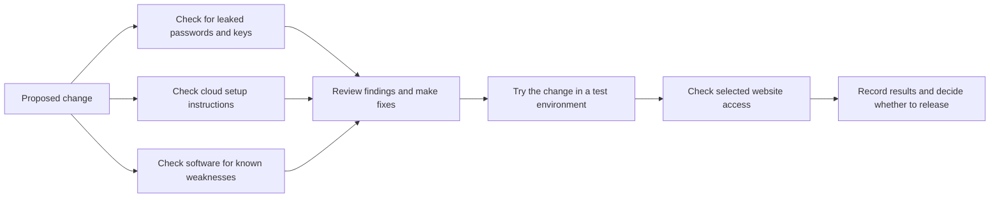

# Layered Security Testing for an Azure Platform

**Check for security problems in four different places, then keep track of the fixes.**

[Business problem](#the-business-problem) · [What was built](#what-was-built) · [Proof](#proof-it-works) · [Run the examples](#run-the-examples)

## The Business Problem

The platform stores private staff records and supports actions that only certain people should perform. Problems can come from a leaked password, an unsafe cloud setting, insecure software or a website that gives the wrong person access.

One tool cannot check all of these. I needed a way to bring the results together and show what was fixed and what still needed attention.

## The Solution

I combined four security tools, each with a different job. Together they check saved code, cloud setup, the software used by the application and selected pages after sign-in.

**Business outcome:** The team has a clearer view of several kinds of security risk and the work needed to address them. Recorded software updates removed seven entries from the findings report. Other findings remained visible for follow-up.

## What Each Tool Checks

| Tool | What it looks for | Why it helps |
| --- | --- | --- |
| **[TruffleHog](tools/trufflehog/README.md)** | Passwords, access keys or similar secrets accidentally saved in code, including older versions. | Editing a file does not remove a secret from its history. |
| **[Checkov](tools/checkov/README.md)** | Risky settings in the instructions used to set up Azure resources. | Problems can be reviewed before those settings are applied. |
| **[Trivy](tools/trivy/README.md)** | Software with known security weaknesses in the application or its packaged runtime. | The team can identify affected software and available updates. |
| **[OWASP ZAP](tools/zap/README.md)** | Problems visible when selected users access the running website and its server functions. | It checks behavior that a review of saved files alone cannot establish. |

A container is a package used to run an application and its supporting software. An API is the set of server functions a website or another program calls. Those terms appear in the detailed guides.

## Architecture



This shows how the checks fit together. The guides explain which steps were automated and which required separate review.

## What Was Built

- Checks for accidentally saved secrets, with private handling of possible matches.
- Checks of cloud setup instructions and software security updates.
- A limited website check comparing users who should be allowed access with users who should be refused.
- Example results, tests, screenshots and instructions for investigating findings.

Each tool keeps its own folder and guide. [Technical source records](docs/CONSOLIDATION-SOURCES.json) identify the exact versions included.

## Proof It Works

The included results show both improvements and remaining work:

| Evidence | Recorded result |
| --- | --- |
| Software review | Seven reported vulnerability entries removed; 21 Medium and one Low remained in the recorded source scan. |
| Cloud setup review | 211 checks passed and 106 failed in the recorded scan; failures remained available for review. |
| Secret review | Three possible matches were checked and identified as public software-package hashes rather than credentials. |
| Website access review | Ten read-only requests were checked, with two informational observations and no Low, Medium or High alerts in that limited sample. |
| Local checks after combining the projects | 52 tests passed; two optional integration tests were skipped. |

These are recorded results from specific checks, not a new assessment of today's platform. [What the checks cover](docs/VALIDATION.md).

<details>
<summary>For engineers: detailed results, examples and commands</summary>

These are **historical scan and test results from the original projects**. They are not a fresh assessment of the platform:

| Layer | Recorded evidence | What it establishes |
| --- | --- | --- |
| Trivy | Seven reported vulnerability entries removed; 21 Medium and one Low remained in the recorded source scan. | Fixes were measured without claiming a completely clean release. |
| Checkov | 508 resources across 228 inputs; 211 passed, 106 failed; no skipped checks or parsing errors. | The scan completed and its outstanding failures were preserved. Counts describe checks, not unique resources. |
| TruffleHog | Three reviewed candidates identified as public package hashes. | Narrow candidate review without broad future exclusions. |
| ZAP | Ten read-only requests across four server handlers; two informational cache observations and no Low/Medium/High alerts in that sample. | Limited authenticated coverage, not assurance about untested routes. |

The [consolidation source map](docs/CONSOLIDATION-SOURCES.json) records the exact public component commits and file hashes copied into this project. Later scans can differ as code and advisory databases change.

### Screenshots

The screenshots below are local reference views with fictional data, not Azure portal captures or live employee records.

| Software and infrastructure | Secrets and runtime access |
| --- | --- |
|  |  |
|  |  |

</details>

## Run the Examples

The examples can be run locally. They use fictional inputs and do not connect to Azure or real user accounts.

<details>
<summary>For engineers: detailed results, examples and commands</summary>

Python 3.12 and Node.js 22 are the reference runtimes. These commands run local contract tests and fictional demonstrations; they do not start Azure services, run live attack scans or deploy infrastructure.

```bash
git clone https://github.com/truthofsource/azure-devsecops-security-scanning.git
cd azure-devsecops-security-scanning
for tool in trufflehog checkov trivy zap; do
  (cd "tools/$tool" && python -B -m unittest discover -s scripts -p 'test_*.py' -v && python -B scripts/demo.py) || exit 1
done
```

Actual scanner commands and prerequisites are documented separately: [Trivy](tools/trivy/docs/COMMANDS.md), [Checkov](tools/checkov/docs/COMMANDS.md), [TruffleHog](tools/trufflehog/docs/COMMANDS.md), and [ZAP](tools/zap/docs/COMMANDS.md). Inspect targets and permissions before adapting those commands. Related infrastructure code remains under the Trivy and Checkov component folders.

The root GitHub Actions check is manual-only and runs these local examples. It does not run the four real scanners, deploy Azure resources or prove current cloud security. No Actions run was dispatched to publish this consolidation.

Checks after combining the projects: **52 tests passed; two optional integration tests skipped**. [Full validation scope](docs/VALIDATION.md).

</details>

## Operations, Scaling and Tradeoffs

Start with the parts of the system affected by a change, then run wider checks separately. As the platform grows, give each finding an owner, a priority and a follow-up date.

The tools cover different risks, but they also create more results to review. Some alerts need investigation before deciding whether they represent a real problem. A completed scan is evidence about what was checked; it does not establish that the whole platform is secure.

## Troubleshooting

| Question | First step |
| --- | --- |
| Why are there no findings? | Confirm the scan finished and covered the intended files or pages. |
| Why is a deleted password still reported? | Check older code versions. If it was a real secret, revoke or replace it. |
| Why is a cloud setting flagged? | Read the rule and assess its cost and service impact before changing it. |
| Why does a fixed issue still appear? | Confirm the new software version was packaged and checked. |
| Why does the website check see only sign-in? | Confirm the test account signed in and the intended pages were reached. |

## Boundaries

This public project draws on actual Azure engineering work, with identifying details removed and fictional examples. It contains no employee records or live credentials. Malware scanning of uploaded documents remains a [separate project](https://github.com/truthofsource/secure-serverless-document-processing), because checking a user's file is a different control from checking application releases.

The four original repositories remain available for existing links. This repository is the combined portfolio entry.
