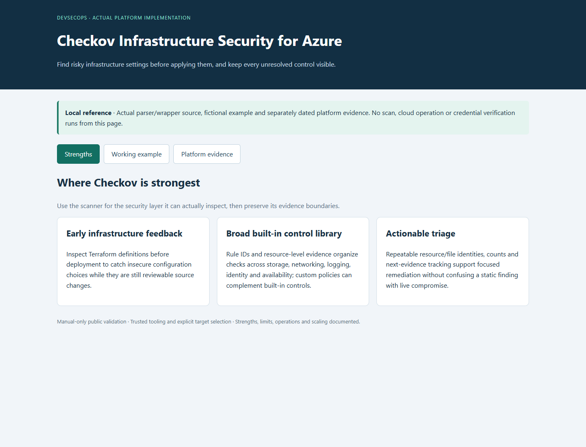
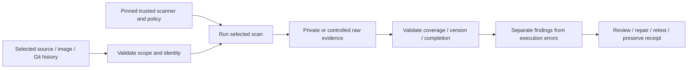
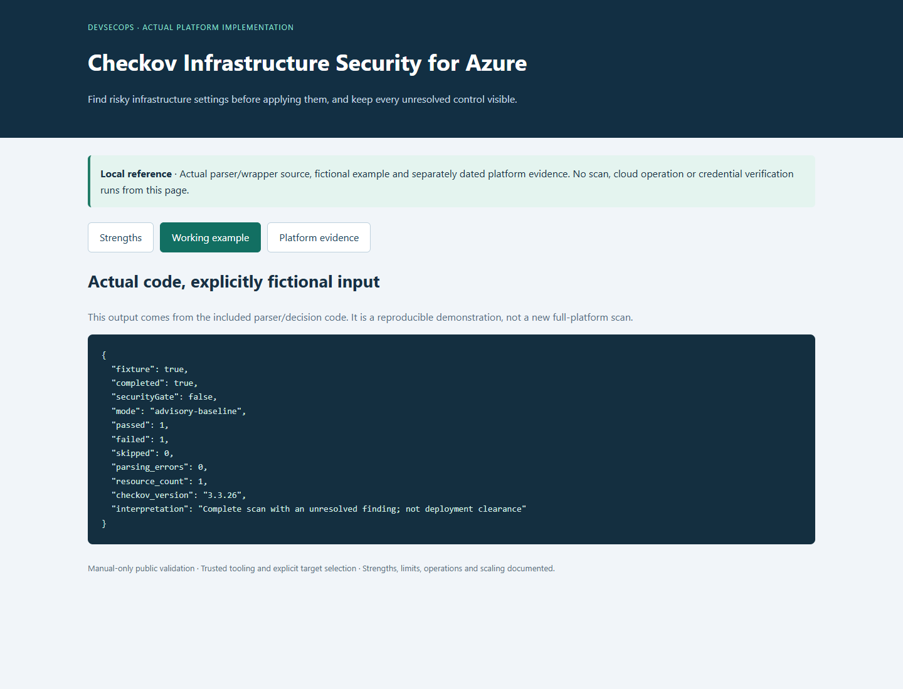

> This example is maintained within **azure-devsecops-security-scanning**. Run its local commands from this subfolder; its nested workflow files are retained examples and are not active repository workflows. See [the consolidation guide](https://github.com/truthofsource/azure-devsecops-security-scanning/blob/main/docs/CONSOLIDATION.md).

# Checkov Infrastructure Security for Azure

**Find risky cloud settings before applying them, and track what still needs attention.**

[Business problem](#the-business-problem) · [Strengths](#where-checkov-is-strong) · [Proof](#proof-it-works) · [Commands](docs/COMMANDS.md) · [Step by step](#step-by-step)



## The Business Problem

The platform's infrastructure defines how databases, document storage, network access, logging and service identities are configured. As more resources are added, reviewing every setting by hand makes it easier for a risky default or missing control to pass unnoticed into a deployment.

An automated failed rule still requires judgment. It may expose a genuine security gap, depend on a service tier the organization has not chosen or flag a design whose protection comes from another verified control. Treating every finding as noise hides work, while treating every recommendation as an immediate purchase or change can add cost and disruption.

The business need was a consistent review of proposed cloud settings, with visible findings, clear ownership and evidence-based follow-up before deciding what to change or release.

## The Solution

Use Checkov to examine the Terraform files that describe the cloud resources. Check that the scan completed properly, keep each failed rule visible, and record what evidence or decision is needed next. Do not treat a completed report as permission to release.

**Business outcome:** The recorded platform scan checked 508 resources across 228 inputs: 211 checks passed and 106 failed, with no skipped checks or reading errors. Remaining findings kept their follow-up requirements.

## Tools Used and What They Do

| Tool or service | What it does | Where it fits |
| --- | --- | --- |
| Checkov | Evaluate infrastructure source against defined configuration checks. | Actual IaC scanner; findings are not a live Azure resource inventory. |
| Terraform | Describe the infrastructure and resolve its intended configuration. | Scanned source; actual plan, service state and functionality need separate evidence. |
| Azure CLI | Inspect the exact service configuration when a finding needs context. | Operating utility, not an automatic remediation step. |
| Python and GitHub Actions | Exercise report and policy decisions using fictional inputs. | Public validation is local/manual-only; it does not apply a Terraform fix. |

This retained tool project remains linked from the combined security-scanning portfolio entry. Historical scanner results keep their original target, date and coverage limits.

## Step by Step

Your own Checkov scan of a Terraform file you create, followed by a documented fix and rescan.

[Open the standalone build guide](docs/BUILD-YOUR-OWN.md) or follow the same complete instructions below.

Start with a new folder, your own files and your own accounts. The numbered steps below describe the build; no portfolio repository checkout is required. The existing implementation/evidence elsewhere in this repository is a separate reference, not a claim that your new build has already passed.

### Prerequisites

Your editor and Checkov prerequisites; a fresh lab folder. This source-only scan needs no Azure deployment or credentials; do not apply the deliberately weak fixture.

Use Bash on Linux/macOS/WSL for Bash blocks and PowerShell for PowerShell blocks. Select the tool versions supported by the official sources below, record the versions you actually install and retain generated dependency locks. Cloud resources, scanner downloads, logs and external AI calls can create costs; review the stated scope before enabling them.

### Create your project folder

Choose a new folder name. These first commands create a blank project; an optional `git init` gives it its own history. Create parent directories in your editor when a later step introduces a nested file.

```bash
mkdir my-checkov-azure-infrastructure-security
cd my-checkov-azure-infrastructure-security
git init
```

Create `.gitignore` before saving credentials or build outputs:

```gitignore
.venv/
node_modules/
.env
.env.*
local.settings.json
credentials.json
token.json
*.pem
*.key
*.tfstate*
*.tfplan
.terraform/
private*/
captures/
backups/
batch.json
reports/
out/
app-config.local.yaml
```

The source/file snippets are a starting implementation you type or paste into the named files. Replace `YOUR_*`, names, regions and addresses only with values from your own lab; do not place real client/employee records in a test project. Keep your terminal in this project root unless a step explicitly changes directory.

Before a first commit, set your own repository-local author with `git config user.name "YOUR_NAME"` and `git config user.email "YOUR_PUBLIC_COMMIT_EMAIL"`. Review `git status --short` and the staged diff before publishing; ignored local files are not a substitute for reviewing what you upload.

### Step 1 — Choose the control and record the tool

**Where:** Your workstation.

Create a Python virtual environment, install Checkov in it and record the resolved package versions. Use the matching platform/interpreter and retain your dependency lock; do not install it globally over unrelated tools.

```bash
python3 -m venv .venv
.venv/bin/python -m pip install checkov
.venv/bin/python -m pip freeze > requirements.lock.txt
.venv/bin/checkov --version
```

**Check before continuing:** The tool version is recorded and its prerequisite check succeeds.

### Step 2 — Create your test infrastructure file

**Where:** A new infra folder.

Create infra/main.tf below, intentionally with a weak TLS setting so you can investigate one concrete control. It is a scanner input, not an approved deployment configuration.

Create **`infra/main.tf`** with the following contents:

```hcl
resource "azurerm_storage_account" "lab" {
  name                     = "myuniquelabstorage"
  resource_group_name      = "rg-my-scanner-lab"
  location                 = "eastus2"
  account_tier             = "Standard"
  account_replication_type = "LRS"
  min_tls_version          = "TLS1_0"
}
```

**Check before continuing:** You have authored the file that the scanner will inspect.

### Step 3 — Run and retain the first scan

**Where:** Your project root.

Create a reports folder and run the command below. Retain the original output and exit status so a later successful scan does not erase what you found.

```bash
mkdir -p reports
.venv/bin/checkov --directory infra --framework terraform --download-external-modules false --output json > reports/checkov.json
```

**Check before continuing:** A parseable report exists; an empty or failed scan is not passed off as success.

### Step 4 — Read the finding in context

**Where:** The JSON report and infra/main.tf.

Inspect the failed TLS rule and resource, change TLS1_0 to TLS1_2, then rerun the same scan. Checkov findings normally produce a nonzero exit; distinguish policy findings from parsing or tool-execution errors.

**Check before continuing:** Your before/after record identifies the exact setting you corrected.

### Step 5 — Prove the changed result

**Where:** Your terminal.

Save a second report under a different filename and compare rule/resource outcomes with the first. Record unresolved findings with an owner and next action rather than deleting scanner rules or claiming scan success means the design is secure.

**Check before continuing:** The TLS correction is observable, and other risks remain visible.

### Step 6 — Add your own repeatable check

**Where:** Your own GitHub repository, optionally.

Create a manual workflow that installs your reviewed tool version, scans this file and retains safe reports. Keep credentials/private reports out of artifacts and use no Azure deployment permission for a source-only scan.

**Check before continuing:** A reader can reproduce the same input, tool version, finding and fix without your portfolio repository.

### Verification and your own screenshots

| Evidence | What to record | Your result |
| --- | --- | --- |
| New build | Your own files/resource settings and tool versions | Not yet recorded |
| Working path | The actual successful request, configuration or recovery result | Not yet recorded |
| Failure boundary | A meaningful denied, malformed, stale or failed case | Not yet recorded |
| Recovery / cleanup | What you restored or removed and what remains billed | Not yet recorded |

Capture your own architecture/configuration, one working result and one failure/recovery result. Keep tokens, credentials, personal records and private identifiers out of public screenshots. Existing portfolio images are references, not evidence that you performed these steps.

### Troubleshooting order

1. Confirm the named file, working directory and selected tool/interpreter.
2. Check the exact input and resource/account selected for the failing step.
3. Separate identity permission, network/DNS reachability and application validation.
4. Keep the actual error and reconcile an unknown write outcome before repeating it; do not widen access or repeat paid operations blindly.

The numbered steps describe a build procedure. Local syntax checks, an accepted API request, a completed hosted operation and a human verification are different evidence levels; fill in the verification table with what you actually observed.

### Official implementation references

- [www.checkov.io — www.checkov.io](https://www.checkov.io/)

The walkthrough layout follows the prerequisites → creation/configuration → test → verification → troubleshooting → cleanup pattern of the [Splunk project reference](https://github.com/davidharris6/splunk-siem-log-analysis). Its Splunk-specific settings are not copied into unrelated projects.

<details>
<summary>Reference: how the existing platform implementation operates</summary>

A short walkthrough of the process, with technical instructions and evidence limits in the sections below.

1. **Select the cloud setup files (Terraform)** — Choose the infrastructure instructions that need review. Record the selected source and scanner version.

2. **Check the settings (Checkov)** — Checkov compares supported settings with its security rules. Its output identifies passed checks, failed checks and any processing problems.

3. **Review each finding** — Decide what a failed rule means for the actual design. Some changes need further evidence, a business decision or cost approval.

4. **Keep the outcome visible** — Preserve unresolved findings and confirm that the scan covered the intended files. This project uses the report for review rather than treating completion as release approval.

</details>

## Where Checkov Is Strong

| Strength | Practical value |
| --- | --- |
| **Early infrastructure feedback** | Check the cloud setup before deployment, while risky settings can still be changed and reviewed in code. |
| **Broad built-in control library** | Use built-in rules to check storage, networks, logs, access and reliability. Add custom rules when the organization needs more specific checks. |
| **Actionable review and prioritization** | Tie each finding to a resource and file, assign follow-up work and record what evidence is needed. A failed rule alone does not prove a system was attacked. |

This tool covers one part of security. The other scanners check different areas, so the results need to be considered together. [Strengths, limits and tradeoffs](docs/STRENGTHS-AND-TRADEOFFS.md).

## Architecture



Each scanner checks a different kind of information and needs suitable protection for its reports. Checkov 3.3.26 is the selected source pin, not a claim that it is the latest release. [Actual source map](docs/SOURCE-MAP.md).

## What Was Built

| Component | Purpose | Implementation |
| --- | --- | --- |
| Scan script | Check the intended files with trusted tools and protect the report | [Source](scripts/security_checkov.py) |
| Existing behavior tests | Reject missing or unreadable reports and checks of the wrong files | [Tests](scripts/) |
| Fixed scanner version and settings | Record the tool version and the rules used | [Configuration](security/) |
| Real pipeline example | Show how the real pipeline runs checks, without running it here | [Inert workflow](reference/workflows/security-checkov-baseline.yml.example) |
| Platform findings | Preserve dated fixes and remaining work | [Recorded findings](data/platform-findings.json) |
| Offline example/viewer | Exercise actual parsing/decision code with fictional inputs | [Example](scripts/demo.py) |

## Proof It Works

### 1. Test the actual boundary code

```bash
python -B -m unittest discover -s scripts -p 'test_*.py' -v
python -B scripts/demo.py
```

**Look for:** 10 original tests. The demonstration using test data is labeled and does not pretend to be a current full-platform scan. [Dated validation](docs/VALIDATION.md) records exact executed/skipped cases.

### 2. Inspect genuine scanner evidence separately

A fresh network-isolated scan of two public storage fixtures produced 14 passed and 16 failed checks, with no skips or parse errors. Specific rules changed from Failed to Passed after the narrow fixture changes; unresolved controls stayed visible. No Terraform was applied.



Local scans cover only this public reference. Dated platform reports are retained as history; local test-example output does not replace or clear the full platform finding register. No cloud credentials, resource changes or provider credential verification are needed.

### 3. Follow findings through to a defensible decision

Keep the target, version, database/policy context and completion evidence. Review the actual finding, apply a compatible fix where justified, repeat the relevant checks and preserve unresolved items. A scanner timeout, incorrectly structured report or missing inventory cannot become a successful scan with zero findings.

### Triage without hiding failures

The [106-occurrence register](data/platform-open-findings.csv) preserves the source resource, rule ID, category, disposition and next evidence. Network controls, logging/retention, key lifecycle and availability/cost remain distinct categories. A source-level graph match is not deployed proof. Paid tiers and additional private endpoints were not activated for scanner score improvements.

The local fixture narrows two storage settings: Shared Key and nested anonymous access. Some related checks improve, but other failures remain. A passing related rule is not a claim that a different feature, such as a SAS policy, was independently deployed.


## Run the Local Viewer

```bash
python -B scripts/preview.py --port 8138
```

Open [the local reference](http://127.0.0.1:8138). It shows strengths, actual parser behavior on fictional input and dated platform evidence. It performs no scan, cloud request or sign-in. Ctrl+C stops it. Screenshots are local captures, not a hosted security dashboard.

## Limitations and Tradeoffs

| Boundary | What it means |
| --- | --- |
| Static context is incomplete | Missing modules, values supplied elsewhere or different ways of meeting a rule may need additional checks. |
| Finding is not exploitability | A failed rule may concern cost, reliability or information the scanner cannot see. It is not proof that a system was compromised. |
| Advisory is not approval | This actual wrapper uses soft-fail for findings; execution, version, parse and coverage errors still fail. It is not a release security gate. |

The reference workflow is manual-only. Actual platform integration examples are inert files outside .github/workflows. No hosted CI run or deployment was performed to create this project. Do not execute candidate package scripts or expose raw secret candidates while adding security checks.

## Troubleshooting Lessons

A narrow configuration operation could still introduce an unintended runtime setting. Plan review had to be followed by exact service readback and a complete reconciliation check. [Read the incident, evidence and verification](docs/LESSONS-LEARNED.md).

## Project Guides

| Guide | Purpose |
| --- | --- |
| [Strengths and tradeoffs](docs/STRENGTHS-AND-TRADEOFFS.md) | Why this scanner, where it helps and where it stops |
| [Process and integration](docs/PROCESS.md) | Scope, trust, completion and CI decisions |
| [Findings and fixes](docs/FINDINGS-AND-FIXES.md) | Recorded results versus local examples |
| [Commands](docs/COMMANDS.md) | Commands to repeat the local checks and start the scanner |
| [Operations](docs/OPERATIONS.md) | Handle failures, protect private data and prioritize findings |
| [Scaling](docs/SCALING.md) | Choose what to scan and manage time, cost and access |
| [Source map](docs/SOURCE-MAP.md) | Where the code came from and what changed for this example |
| [Validation](docs/VALIDATION.md) | Local test results and their limits |

Related projects: [Trivy](https://github.com/truthofsource/azure-devsecops-security-scanning/tree/main/tools/trivy), [TruffleHog](https://github.com/truthofsource/azure-devsecops-security-scanning/tree/main/tools/trufflehog), [Checkov](https://github.com/truthofsource/azure-devsecops-security-scanning/tree/main/tools/checkov), and [delivery/rollback](https://github.com/truthofsource/azure-container-lifecycle/tree/main/examples/signed-container-delivery).
