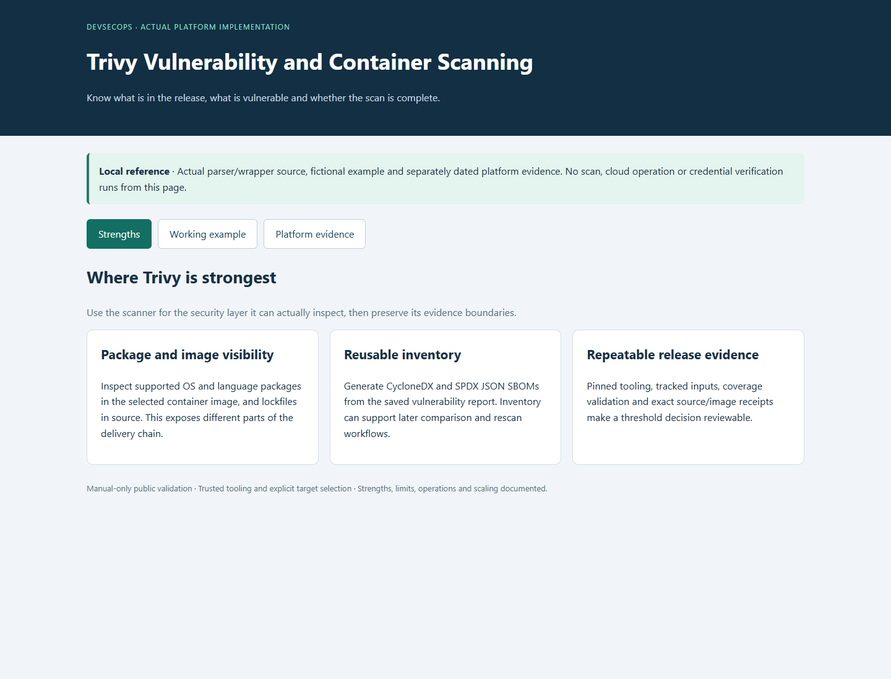
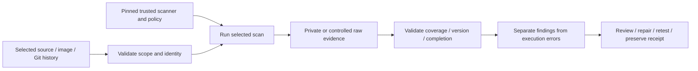
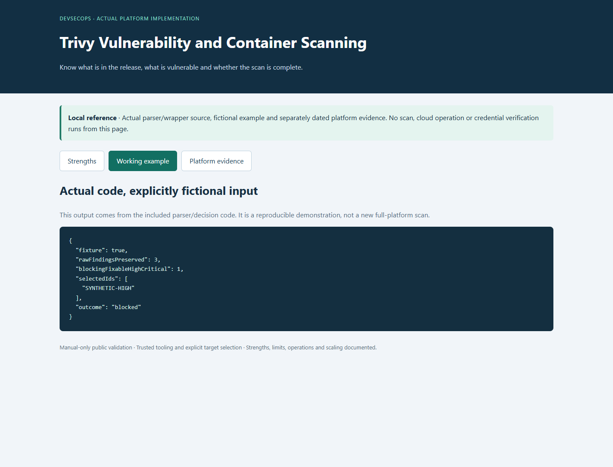

# Trivy Vulnerability and Container Scanning

**See what software a release contains, what weaknesses were found and whether the check finished.**

[Business problem](#the-business-problem) · [Strengths](#where-trivy-is-strong) · [Proof](#proof-it-works) · [Commands](docs/COMMANDS.md)



## The Business Problem

The platform releases Node.js applications and container-based background jobs. Checking source files alone can miss operating-system packages inside a container, while checking only the container can miss development packages. Reports need to identify the exact version that was checked.

## The Solution

Use a verified version of Trivy to inspect selected source files and container images. Keep all findings, create software inventories, and apply a separate release rule for High or Critical issues with an available fix. Keep software and infrastructure findings separate.

**Business outcome:** Recorded compatible package updates removed seven reported occurrences. The source scan still showed 21 Medium and one Low occurrence, so it was not described as a completely clean release.

## Where Trivy Is Strong

| Strength | Practical value |
| --- | --- |
| **Package and image visibility** | Check supported operating-system and application packages inside a container, plus the recorded package versions in source code. These checks cover different parts of a release. |
| **Reusable inventory** | Create software lists in the standard CycloneDX and SPDX JSON formats. These lists, called SBOMs, help compare releases and check packages again later. |
| **Repeatable release evidence** | Record the scanner version, the checked files and the exact release. Confirm that the scan finished before applying the release rules. |

This tool covers one part of security. The other scanners check different areas, so the results need to be considered together. [Strengths, limits and tradeoffs](docs/STRENGTHS-AND-TRADEOFFS.md).

## Architecture



Each scanner checks a different kind of information and needs suitable protection for its reports. Trivy 0.75.0 is the selected source pin, not a claim that it is the latest release. [Actual source map](docs/SOURCE-MAP.md).

## What Was Built

| Component | Purpose | Implementation |
| --- | --- | --- |
| Scan script | Check the intended files with trusted tools and protect the report | [Source](scripts/security_scan.py) |
| Existing behavior tests | Reject missing or unreadable reports and checks of the wrong files | [Tests](scripts/) |
| Fixed scanner version and settings | Record the tool version and the rules used | [Configuration](security/) |
| Real pipeline example | Show how the real pipeline runs checks, without running it here | [Inert workflow](reference/workflows/security-release.yml.example) |
| Platform findings | Preserve dated fixes and remaining work | [Recorded findings](data/platform-findings.json) |
| Offline example/viewer | Exercise actual parsing/decision code with fictional inputs | [Example](scripts/demo.py) |

## Proof It Works

### 1. Test the actual boundary code

```bash
python -B -m unittest discover -s scripts -p 'test_*.py' -v
python -B scripts/demo.py
```

**Look for:** 12 original tests. The demonstration using test data is labeled and does not pretend to be a current full-platform scan. [Dated validation](docs/VALIDATION.md) records exact executed/skipped cases.

### 2. Inspect genuine scanner evidence separately

A real local scan of the public API lockfile inventoried six packages and reported zero vulnerabilities against the existing local database. Configuration fixtures were scanned separately, and both CycloneDX and SPDX JSON were generated. The test-only gate demonstration intentionally blocks one fixable High finding while retaining all three raw fixture findings.



Local scans cover only this public reference. Dated platform reports are retained as history; local test-example output does not replace or clear the full platform finding register. No cloud credentials, resource changes or provider credential verification are needed.

### 3. Follow findings through to a defensible decision

Keep the target, version, database/policy context and completion evidence. Review the actual finding, apply a compatible fix where justified, repeat the relevant checks and preserve unresolved items. A scanner timeout, incorrectly structured report or missing inventory cannot become a successful scan with zero findings.

### Recorded compatible fixes

| Dependency | Selected repair | Why it matters |
| --- | --- | --- |
| Backstage catalog backend | 4.0.0 → 4.0.2 | Repair the affected catalog-location validation path |
| fast-uri | 3.1.8 → 3.1.9 | Address URI scheme/host/path advisories without forcing a new major |
| qs | Compatible 6.x ranges → 6.16.2 | Repair hostile query-array serialization while preserving newer instances |
| postcss-selector-parser | Affected 6.x/7.x lines → their compatible patch | Avoid breaking consumers by imposing one major on every parent |

The dated source evidence went from 26 Medium/three Low to 21 Medium/one Low occurrences. The seven removed occurrences and exact advisory identifiers are in [the platform finding record](data/platform-findings.json). Remaining infrastructure findings and expired-baseline state are separate from dependency thresholds. These are recorded source repairs, not a new scan or deployment of every live image.


## Run the Local Viewer

```bash
python -B scripts/preview.py --port 8138
```

Open [the local reference](http://127.0.0.1:8138). It shows strengths, actual parser behavior on fictional input and dated platform evidence. It performs no scan, cloud request or sign-in. Ctrl+C stops it. Screenshots are local captures, not a hosted security dashboard.

## Limitations and Tradeoffs

| Boundary | What it means |
| --- | --- |
| Coverage follows target | Checking source files is different from checking the released container. A package finding does not by itself prove the application can be attacked. |
| Database age matters | The local reference used an existing DB without updating it; no vulnerability result is timeless. |
| Threshold is policy | Unfixed and Medium findings remain visible even when a fixable High/Critical threshold does not block. |

The reference workflow is manual-only. Actual platform integration examples are inert files outside .github/workflows. No hosted CI run or deployment was performed to create this project. Do not execute candidate package scripts or expose raw secret candidates while adding security checks.

## Project Guides

| Guide | Purpose |
| --- | --- |
| [Strengths and tradeoffs](docs/STRENGTHS-AND-TRADEOFFS.md) | Why this scanner, where it helps and where it stops |
| [Process and integration](docs/PROCESS.md) | Scope, trust, completion and CI decisions |
| [Findings and fixes](docs/FINDINGS-AND-FIXES.md) | Recorded results versus local examples |
| [Commands](docs/COMMANDS.md) | Commands to repeat the local checks and start the scanner |
| [Operations](docs/OPERATIONS.md) | Handle failures, protect private data and prioritize findings |
| [Scaling](docs/SCALING.md) | Choose what to scan and manage time, cost and access |
| [Source map](docs/SOURCE-MAP.md) | Where the code came from and what changed for this example |
| [Validation](docs/VALIDATION.md) | Local test results and their limits |

Related projects: [Trivy](https://github.com/truthofsource/trivy-vulnerability-management), [TruffleHog](https://github.com/truthofsource/trufflehog-secret-detection), [Checkov](https://github.com/truthofsource/checkov-azure-infrastructure-security), and [delivery/rollback](https://github.com/truthofsource/secure-container-delivery-and-rollback).
