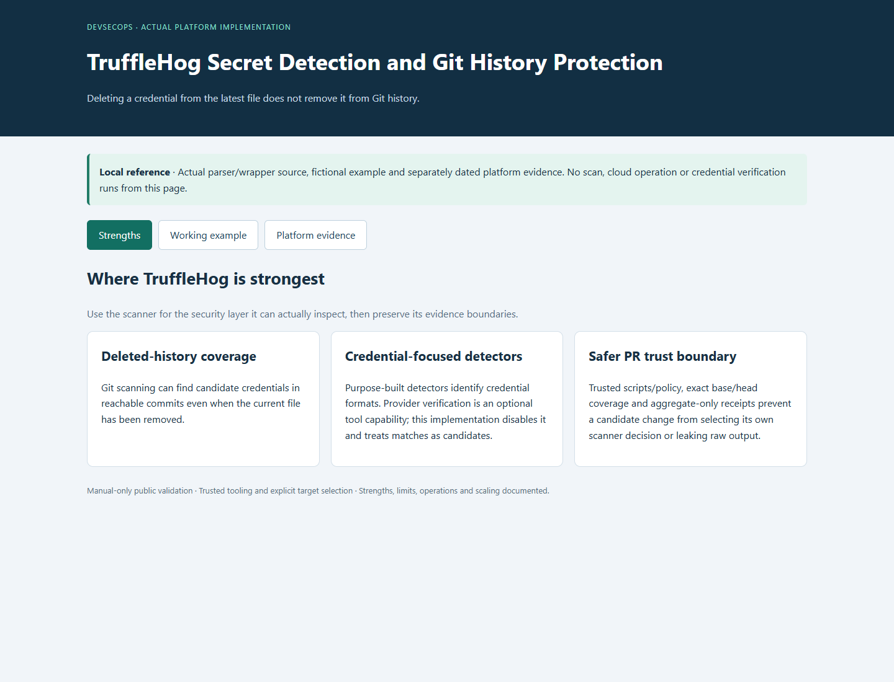
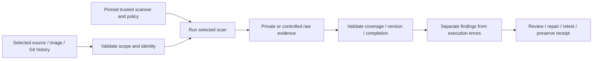
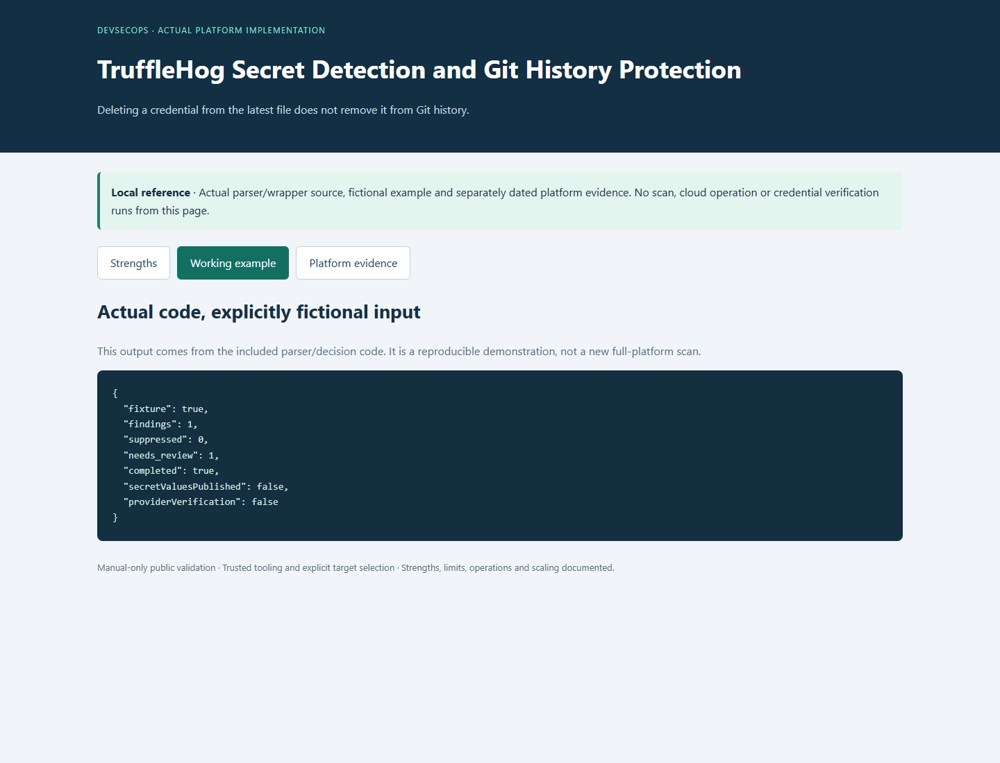

> This example is maintained within **azure-devsecops-security-scanning**. Run its local commands from this subfolder; its nested workflow files are retained examples and are not active repository workflows. See [the consolidation guide](https://github.com/truthofsource/azure-devsecops-security-scanning/blob/main/docs/CONSOLIDATION.md).

# TruffleHog Secret Detection and Git History Protection

**Find possible leaked credentials, including ones deleted from the latest files.**

[Business problem](#the-business-problem) · [Strengths](#where-trufflehog-is-strong) · [Proof](#proof-it-works) · [Commands](docs/COMMANDS.md) · [Step by step](#step-by-step)



## The Business Problem

Engineers work with configuration, deployment scripts and integration code that may reference passwords, tokens or service keys. If a usable credential reaches Git history, deleting it from the newest file leaves older copies available. That can create an access problem even after the visible code looks corrected.

Investigating scanner results brings its own work: some matches are harmless package hashes, while others require urgent review and credential replacement. Publishing the raw finding can expose the value again. Broad exclusions added to quiet false alarms can also hide a later genuine leak.

The business need was to detect possible credential exposure across the relevant history, give reviewers enough context to act and keep both the suspected values and future scanning coverage protected.

## The Solution

Use a fixed version of TruffleHog to inspect the selected Git history or proposed change. Run trusted scanning code with read-only access and no network inside the scanning container. Check that coverage is complete and publish counts rather than possible secret values.

**Business outcome:** The process checks deleted history and keeps possible secrets private. A recorded review confirmed that three candidates were public package hashes, without adding broad rules that hide future findings.

## Tools Used and What They Do

| Tool or service | What it does | Where it fits |
| --- | --- | --- |
| TruffleHog | Look for possible secrets in the selected files and Git history. | Actual detector; a candidate is not automatically a confirmed exposed credential. |
| Git | Provide the source history and exact refs under review. | History coverage must be checked, not assumed from the current working file. |
| Docker | Provide a pinned scanner execution option in the operating instructions. | Optional scanner runtime, separate from the Python teaching model. |
| Python and GitHub Actions | Test coverage/report handling with fictional candidates. | Public validation is local/manual-only and does not publish raw possible secrets. |

This retained tool project remains linked from the combined security-scanning portfolio entry. Historical scanner results keep their original target, date and coverage limits.

## Step by Step

A secret-history exercise in a Git repository you create, using an unused local test key and no online credential verification.

[Open the standalone build guide](docs/BUILD-YOUR-OWN.md) or follow the same complete instructions below.

Start with a new folder, your own files and your own accounts. The numbered steps below describe the build; no portfolio repository checkout is required. The existing implementation/evidence elsewhere in this repository is a separate reference, not a claim that your new build has already passed.

### Prerequisites

Git, OpenSSL and a reviewed TruffleHog installation. Use a disposable repository only; never add an actual cloud credential or private employee data.

Use Bash on Linux/macOS/WSL for Bash blocks and PowerShell for PowerShell blocks. Select the tool versions supported by the official sources below, record the versions you actually install and retain generated dependency locks. Cloud resources, scanner downloads, logs and external AI calls can create costs; review the stated scope before enabling them.

### Create your project folder

Choose a new folder name. These first commands create a blank project; an optional `git init` gives it its own history. Create parent directories in your editor when a later step introduces a nested file.

```bash
mkdir my-trufflehog-secret-detection
cd my-trufflehog-secret-detection
git init
```

Create `.gitignore` before saving credentials or build outputs:

```gitignore
.venv/
node_modules/
.env
.env.*
local.settings.json
credentials.json
token.json
*.pem
*.key
*.tfstate*
*.tfplan
.terraform/
private*/
captures/
backups/
batch.json
reports/
out/
app-config.local.yaml
```

The source/file snippets are a starting implementation you type or paste into the named files. Replace `YOUR_*`, names, regions and addresses only with values from your own lab; do not place real client/employee records in a test project. Keep your terminal in this project root unless a step explicitly changes directory.

Before a first commit, set your own repository-local author with `git config user.name "YOUR_NAME"` and `git config user.email "YOUR_PUBLIC_COMMIT_EMAIL"`. Review `git status --short` and the staged diff before publishing; ignored local files are not a substitute for reviewing what you upload.

### Step 1 — Initialize your own repository

**Where:** Your empty lab folder.

Initialize Git and set your own commit author if needed. Record the TruffleHog version and create no connection to a real provider account.

```bash
git init
trufflehog --version
```

**Check before continuing:** Your repository has no inherited portfolio history.

### Step 2 — Create an unused test-only key

**Where:** The disposable folder.

Generate a key solely for this exercise, never register its public key with any service, and commit it once. This deliberately creates a history finding without exposing a working cloud credential.

```bash
openssl genpkey -algorithm RSA -pkeyopt rsa_keygen_bits:2048 -out UNUSED_LAB_KEY.pem
git add UNUSED_LAB_KEY.pem
git commit -m "Add unused key for detection exercise"
```

**Check before continuing:** One disposable commit contains the test key.

### Step 3 — Delete the current file and inspect history

**Where:** The same repository.

Delete the unused key from the current tree and commit that deletion. Notice that Git can still read it from the earlier commit; deleting a working file is not history cleanup or credential revocation.

```bash
git rm UNUSED_LAB_KEY.pem
git commit -m "Remove unused key from current tree"
git log --oneline
```

**Check before continuing:** Your latest tree has no key file, while history still contains the test commit.

### Step 4 — Run the history scan

**Where:** Your terminal.

Run TruffleHog with online verification disabled and retain its output privately. Some output can contain the detected value, so do not upload a raw report to your public project.

```bash
trufflehog git "file://$PWD" --no-verification --json > ../private-secret-findings.json
```

**Check before continuing:** The scan examines your Git history; record the detected key candidate and tool outcome without publishing its bytes.

### Step 5 — Explain the remediation decision

**Where:** Your report notes.

For this unused key, record that no provider-side credential was ever active. For a genuine finding, revoke/rotate at the provider first, investigate use and then handle Git history and copies under the owning team process.

**Check before continuing:** You distinguish detection, revocation, investigation and history cleanup.

### Step 6 — Retire the disposable material

**Where:** Your lab folder.

Remove the entire disposable repository and private report only after saving a value-free finding summary. Do not rewrite a shared repository as an automatic cleanup step.

**Check before continuing:** No unused private key or raw secret-bearing report remains in your public evidence.

### Verification and your own screenshots

| Evidence | What to record | Your result |
| --- | --- | --- |
| New build | Your own files/resource settings and tool versions | Not yet recorded |
| Working path | The actual successful request, configuration or recovery result | Not yet recorded |
| Failure boundary | A meaningful denied, malformed, stale or failed case | Not yet recorded |
| Recovery / cleanup | What you restored or removed and what remains billed | Not yet recorded |

Capture your own architecture/configuration, one working result and one failure/recovery result. Keep tokens, credentials, personal records and private identifiers out of public screenshots. Existing portfolio images are references, not evidence that you performed these steps.

### Troubleshooting order

1. Confirm the named file, working directory and selected tool/interpreter.
2. Check the exact input and resource/account selected for the failing step.
3. Separate identity permission, network/DNS reachability and application validation.
4. Keep the actual error and reconcile an unknown write outcome before repeating it; do not widen access or repeat paid operations blindly.

The numbered steps describe a build procedure. Local syntax checks, an accepted API request, a completed hosted operation and a human verification are different evidence levels; fill in the verification table with what you actually observed.

### Official implementation references

- [github.com — trufflehog](https://github.com/trufflesecurity/trufflehog)

The walkthrough layout follows the prerequisites → creation/configuration → test → verification → troubleshooting → cleanup pattern of the [Splunk project reference](https://github.com/davidharris6/splunk-siem-log-analysis). Its Splunk-specific settings are not copied into unrelated projects.

<details>
<summary>Reference: how the existing platform implementation operates</summary>

A short walkthrough of the process, with technical instructions and evidence limits in the sections below.

1. **Choose the code history (Git)** — Select the repository history or proposed change that needs checking. Confirm that the required history is present before starting.

2. **Look for possible secrets (TruffleHog)** — TruffleHog examines the selected content for passwords, access keys and similar values. The scan uses trusted rules and does not publish the possible secret values.

3. **Review matches privately** — Determine whether a candidate is a real secret or harmless content. This setup disables online checks of whether a possible credential works.

4. **Repair and record the result** — Revoke or replace a real exposed secret before considering history cleanup. Keep the review outcome without adding broad exclusions that could hide future problems.

</details>

## Where TruffleHog Is Strong

| Strength | Practical value |
| --- | --- |
| **Deleted-history coverage** | Search earlier Git versions for possible credentials, even after a file is deleted. |
| **Credential-focused detectors** | Look for patterns used by passwords, keys and tokens. The tool can optionally check whether a credential works; this setup disables that step and reviews matches privately. |
| **Safer PR trust boundary** | Use scanning code from the trusted base version, check the exact proposed change and publish counts only. The proposed code cannot choose its own rules or expose possible secret values. |

This tool covers one part of security. The other scanners check different areas, so the results need to be considered together. [Strengths, limits and tradeoffs](docs/STRENGTHS-AND-TRADEOFFS.md).

## Architecture



Each scanner checks a different kind of information and needs suitable protection for its reports. TruffleHog 3.99.4 is the selected source pin, not a claim that it is the latest release. [Actual source map](docs/SOURCE-MAP.md).

## What Was Built

| Component | Purpose | Implementation |
| --- | --- | --- |
| Scan script | Check the intended files with trusted tools and protect the report | [Source](scripts/trufflehog_scan.py) |
| Existing behavior tests | Reject missing or unreadable reports and checks of the wrong files | [Tests](scripts/) |
| Fixed scanner version and settings | Record the tool version and the rules used | [Configuration](security/) |
| Real pipeline example | Show how the real pipeline runs checks, without running it here | [Inert workflow](reference/workflows/trufflehog-pr.yml.example) |
| Platform findings | Preserve dated fixes and remaining work | [Recorded findings](data/platform-findings.json) |
| Offline example/viewer | Exercise actual parsing/decision code with fictional inputs | [Example](scripts/demo.py) |

## Proof It Works

### 1. Test the actual boundary code

```bash
python -B -m unittest discover -s scripts -p 'test_*.py' -v
python -B scripts/demo.py
```

**Look for:** 21 passing original contract cases; two optional integration cases are separately recorded. The demonstration using test data is labeled and does not pretend to be a current full-platform scan. [Dated validation](docs/VALIDATION.md) records exact executed/skipped cases.

### 2. Inspect genuine scanner evidence separately

The parser demonstration accepts a fictional candidate and emits only counts. A separate real scanner test uses a disposable repository and an unregistered generated key that is committed and deleted; its exact observed outcome is recorded in Validation. No test key or raw scanner output is published.



Local scans cover only this public reference. Dated platform reports are retained as history; local test-example output does not replace or clear the full platform finding register. No cloud credentials, resource changes or provider credential verification are needed.

### 3. Follow findings through to a defensible decision

Keep the target, version, database/policy context and completion evidence. Review the actual finding, apply a compatible fix where justified, repeat the relevant checks and preserve unresolved items. A scanner timeout, incorrectly structured report or missing inventory cannot become a successful scan with zero findings.

### Privacy and history coverage

The actual implementation rejects incomplete/shallow/rewritten history, unsupported local Git configuration, a moved head and mismatched completion records. PR mode binds base, head and merge base. Raw candidate output and diagnostic files remain private and bounded; the safe parser excludes Raw, Redacted and ExtraData values from its aggregate output.

The public wrapper's allowed origin is changed to this project; it must not be broadened to arbitrary repositories as an unexplained convenience. Exact, expiring suppressions are separate from global scanner ignores. If a real credential is exposed, revoke/rotate it and review usage; removing a file or rewriting history alone does not revoke it.


## Run the Local Viewer

```bash
python -B scripts/preview.py --port 8138
```

Open [the local reference](http://127.0.0.1:8138). It shows strengths, actual parser behavior on fictional input and dated platform evidence. It performs no scan, cloud request or sign-in. Ctrl+C stops it. Screenshots are local captures, not a hosted security dashboard.

## Limitations and Tradeoffs

| Boundary | What it means |
| --- | --- |
| A candidate needs review | A match does not prove that a working credential was exposed. Some matches, such as public package hashes, need review before a decision. |
| Scope is explicit | A main-history or PR-range scan is not every branch, ref, artifact, image or external mailbox. |
| Offline means no live validity test | Network none and no-verification reduce exposure, but cannot establish whether a candidate works against a provider. |

The reference workflow is manual-only. Actual platform integration examples are inert files outside .github/workflows. No hosted CI run or deployment was performed to create this project. Do not execute candidate package scripts or expose raw secret candidates while adding security checks.

## Troubleshooting Lessons

Three detector candidates were public package hashes rather than credentials. The useful outcome was a narrow evidence-based classification, not a rule that future similar-looking values should be ignored. [Read the incident, evidence and verification](docs/LESSONS-LEARNED.md).

## Project Guides

| Guide | Purpose |
| --- | --- |
| [Strengths and tradeoffs](docs/STRENGTHS-AND-TRADEOFFS.md) | Why this scanner, where it helps and where it stops |
| [Process and integration](docs/PROCESS.md) | Scope, trust, completion and CI decisions |
| [Findings and fixes](docs/FINDINGS-AND-FIXES.md) | Recorded results versus local examples |
| [Commands](docs/COMMANDS.md) | Commands to repeat the local checks and start the scanner |
| [Operations](docs/OPERATIONS.md) | Handle failures, protect private data and prioritize findings |
| [Scaling](docs/SCALING.md) | Choose what to scan and manage time, cost and access |
| [Source map](docs/SOURCE-MAP.md) | Where the code came from and what changed for this example |
| [Validation](docs/VALIDATION.md) | Local test results and their limits |

Related projects: [Trivy](https://github.com/truthofsource/azure-devsecops-security-scanning/tree/main/tools/trivy), [TruffleHog](https://github.com/truthofsource/azure-devsecops-security-scanning/tree/main/tools/trufflehog), [Checkov](https://github.com/truthofsource/azure-devsecops-security-scanning/tree/main/tools/checkov), and [delivery/rollback](https://github.com/truthofsource/azure-container-lifecycle/tree/main/examples/signed-container-delivery).
